# Retained Hearthwild visual context

[User visual feedback](../parallel/CLAUDE_VISUAL_FEEDBACK.md) · [Available chat context](../parallel/chat-context/README.md) · [HTML gallery](archive/index.html) · [File hashes and provenance](VISUAL_TRANSFER_MANIFEST.json)

Original H (bottom-middle orange carved wood) leads; original E (top-middle painted landscape) is the close second. The later H/E comparison did not reproduce original H faithfully. Concept approval does not establish current model fidelity or completed game integration.

## Latest actual 3D work

[Option H procedural Three.js model study](prototypes/option-h/option-h-model-proof.html) — actual geometry code with seeded homes, material choices, three traditions, camera views and working waterwheel study. HTML source requires a WebGL-capable host and Three.js 0.185.1 from jsDelivr; GitHub displays its source.

[Companion geometry check](prototypes/option-h/option-h-model-proof-check.mjs) resolves installed Three.js portably. Run from a checkout with project dependencies: `node docs/art-reference/prototypes/option-h/option-h-model-proof-check.mjs`. This validates deterministic geometry without WebGL; it does not establish browser or game acceptance.

## Actual exported wonder blockouts

Static architectural shape/scale reviews in metre units, Y up: [Ring Observatory](archive/3d-prototypes/ring-observatory.glb), [Crescent Harbor](archive/3d-prototypes/crescent-harbor.glb), [Cascade Gardens](archive/3d-prototypes/cascade-gardens.glb). [Model metadata](archive/3d-prototypes/wonder-blockouts.json) · [Integration caveats](archive/3d-prototypes/README.md) · [Reproducible exporter](../../scripts/art/export-wonder-blockouts.mjs).

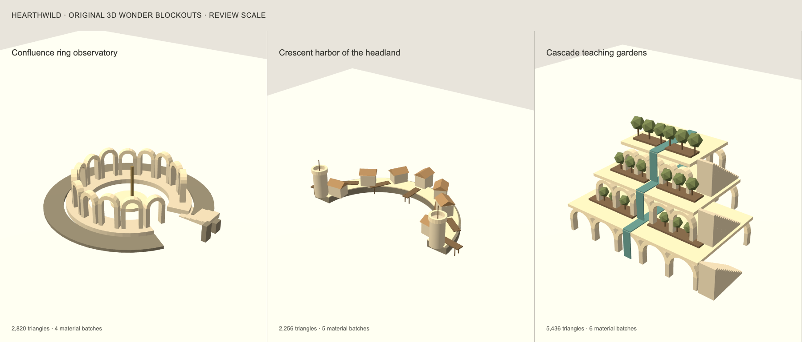

These models need terrain contacts, entrances, collisions, construction phases, costs, animation and distance detail before game integration.

## Every retained concept sheet

Generated concept images follow; they are not screenshots of implemented gameplay. Original style and approved wonder sheets retain their established repository paths.

### Retained concept 1

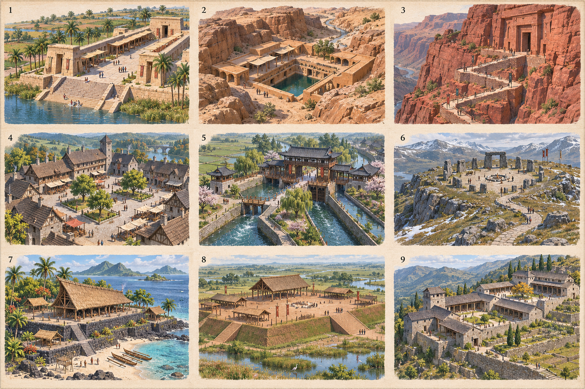

### Approved civic and wonder concepts

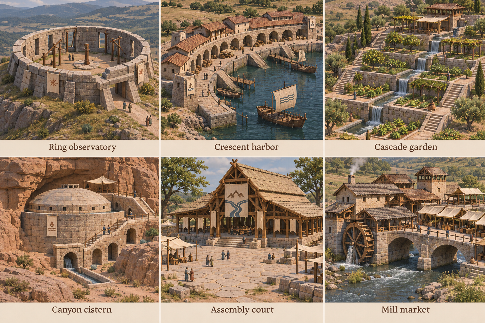

### Retained concept 3

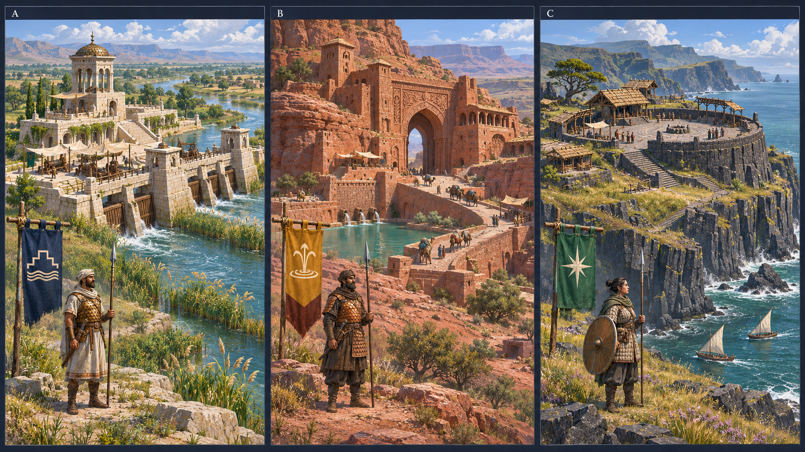

### Retained concept 4

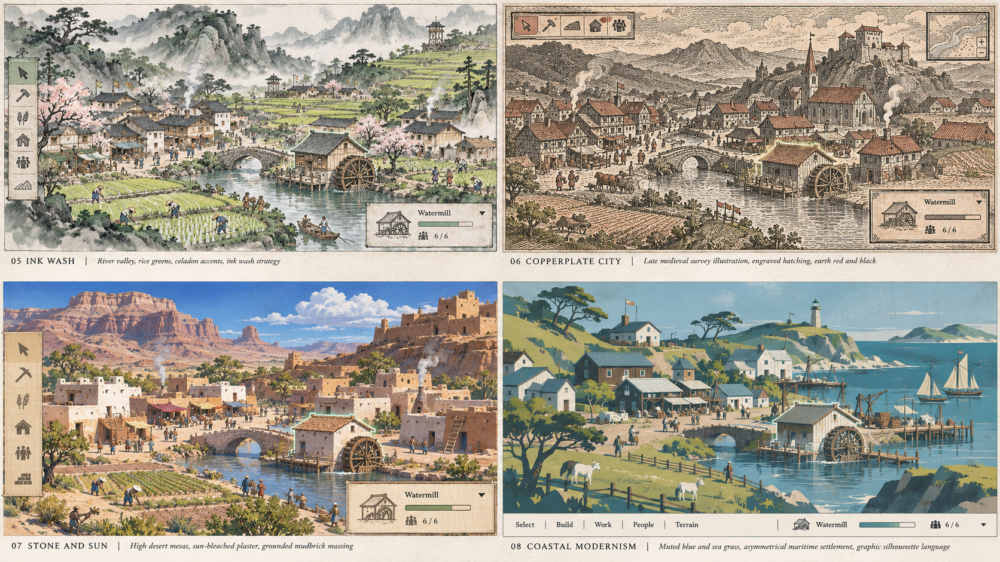

### Retained concept 5

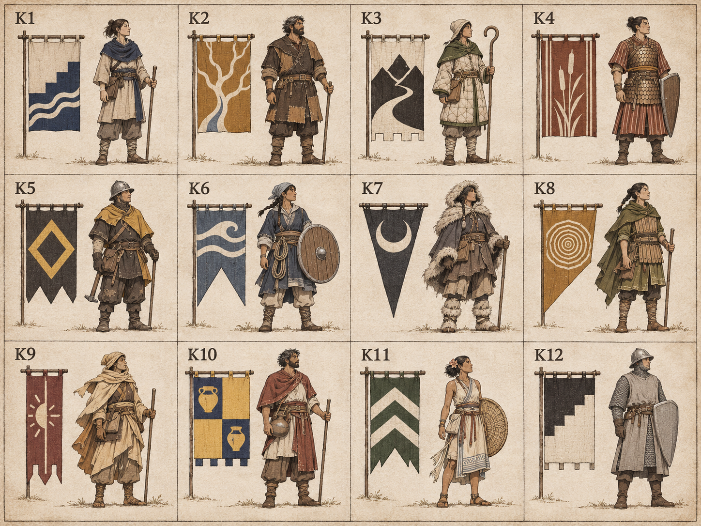

### Retained concept 6

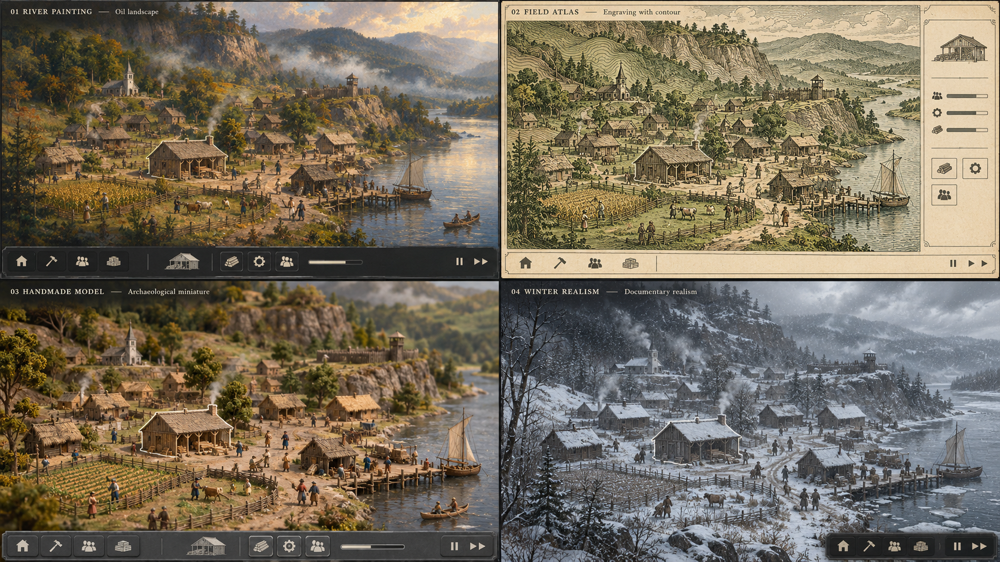

### Retained concept 7

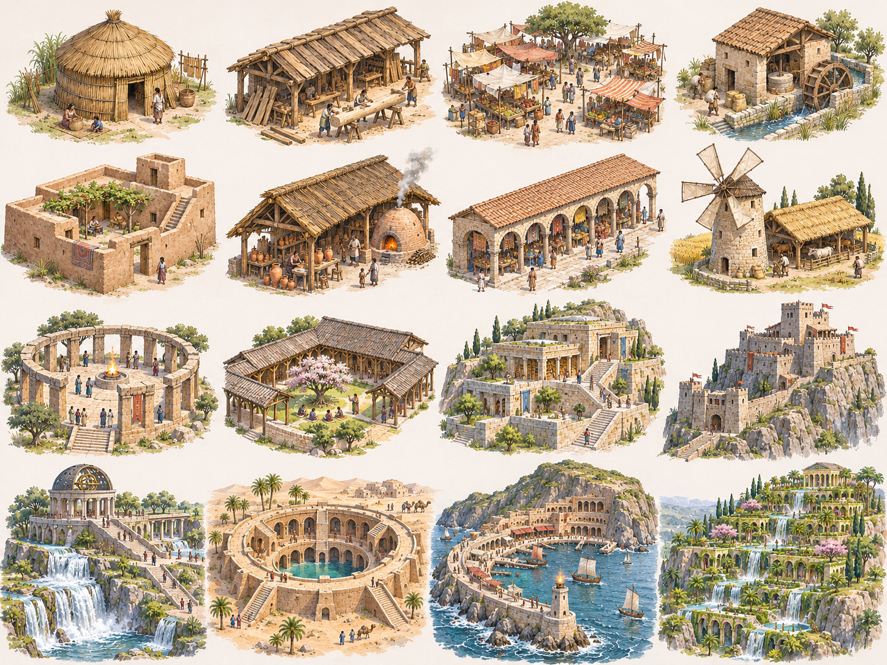

### Retained concept 8

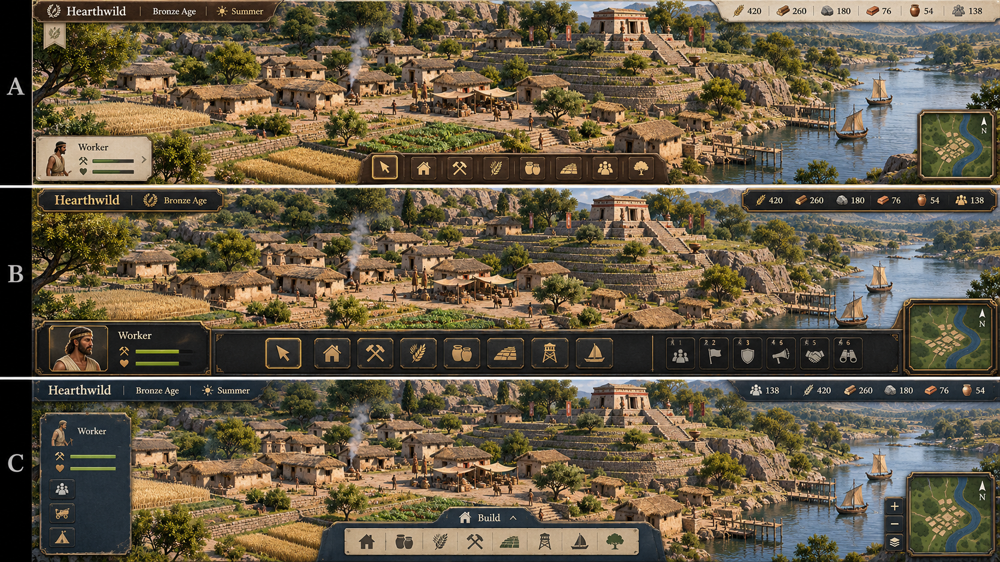

### Original D–I style sheet (H and E)

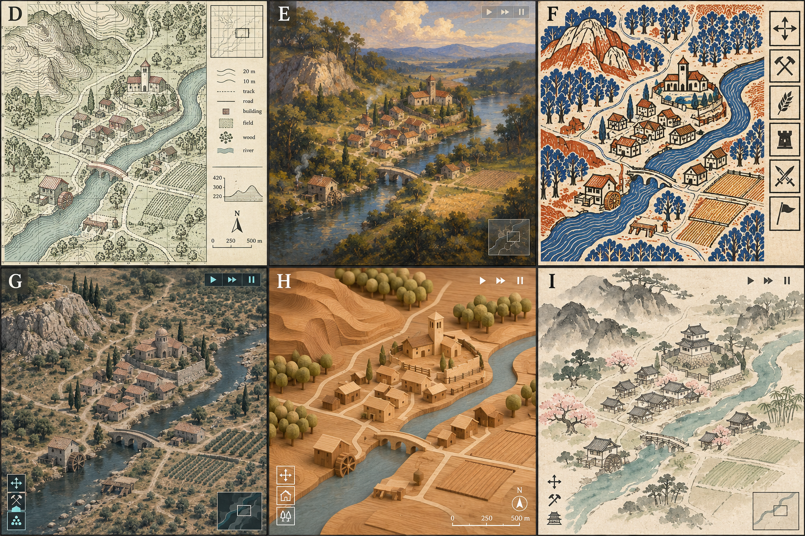

### Retained concept 10

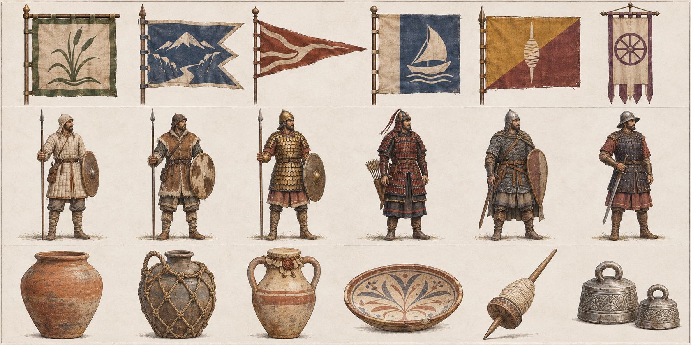

### H/E generated comparison (not faithful to original H)

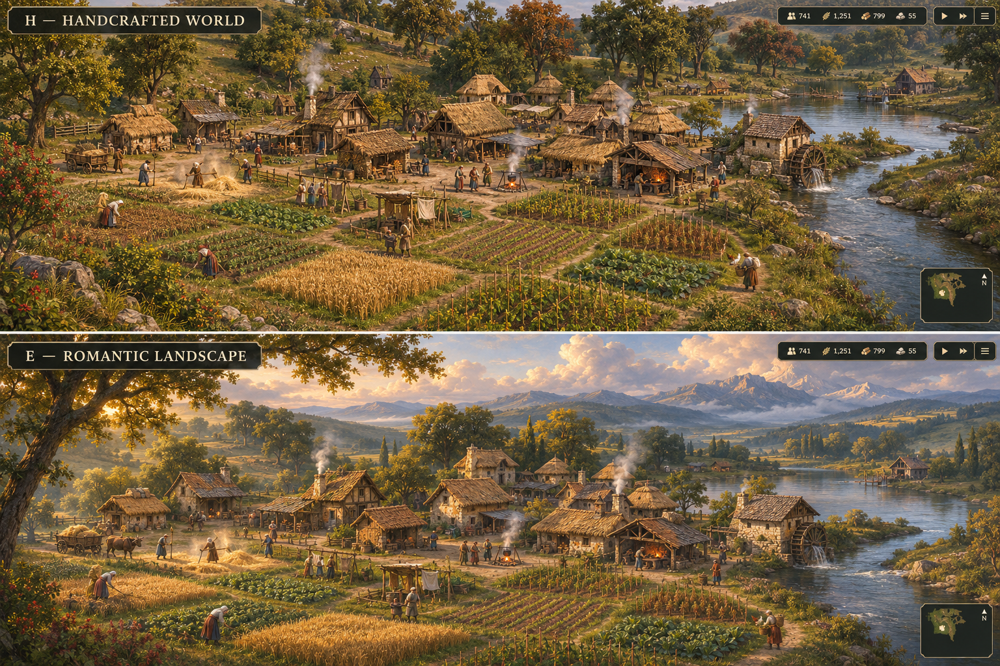

### Retained concept 12

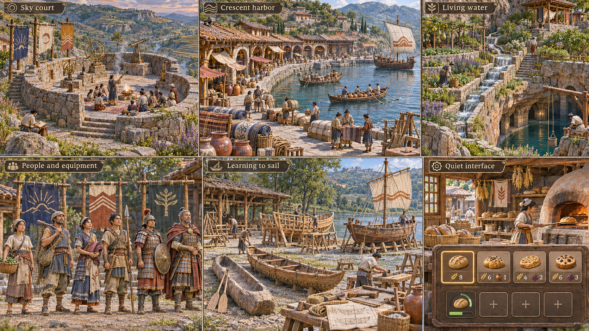

### Retained concept 13

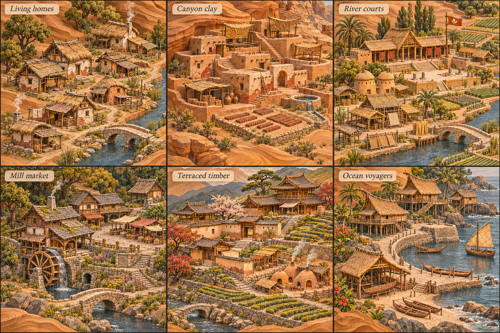
